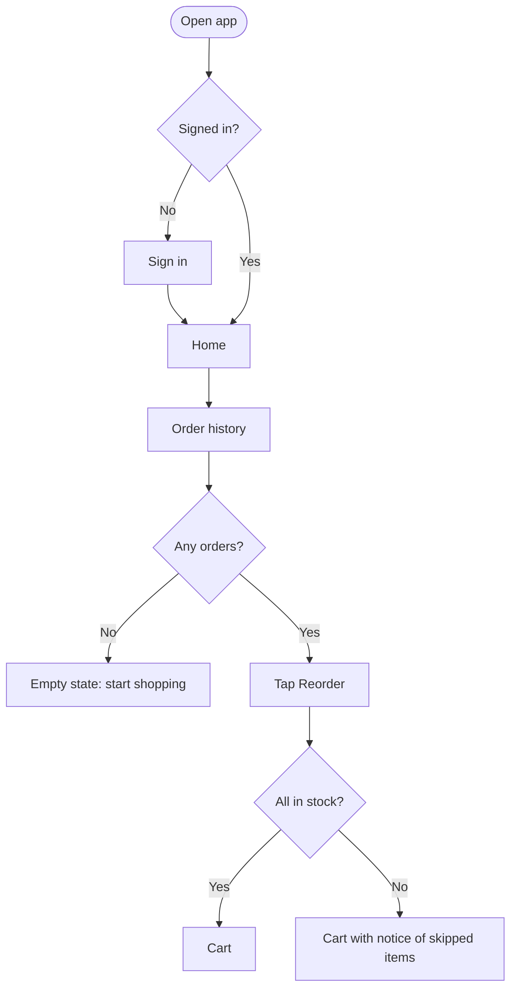

# UX research toolkit

## Research plan

```markdown
# Research plan: <topic>

**Goal:** <decision this research informs>
**Questions:** <three to five things we need to learn>
**Method:** interviews | usability test | survey | analytics review | diary study
**Participants:** <who, how many, how recruited>
**Timeline:** <dates>
**Output:** findings report with prioritised recommendations
```

## Interview guide (30–45 minutes)

1. **Intro (2 min):** purpose, consent to take notes or record, no wrong answers.
2. **Context (5 min):** role, routine, tools they use today.
3. **Past behaviour (20 min):** "Tell me about the last time you…", "What did you
   do next?", "What was hardest?". Ask for stories, not opinions.
4. **Workarounds (5 min):** "Have you tried anything else?", "What did it cost you?"
5. **Wrap up (3 min):** "Anything I should have asked?"

Avoid leading or future-hypothetical questions ("Would you use…?").

## Usability test script

1. Explain: we are testing the design, not you; think aloud.
2. Give three to five realistic tasks, for example "You want to reorder last
   week's groceries. Show me how."
3. Observe without helping. Note where they hesitate, err, or succeed.
4. After each task: "How easy was that, 1 to 5?"
5. At the end: "What was most confusing?"

Five participants per user group usually reveal most major issues.

## Findings report

| # | Finding | Evidence | Severity (0–4) | Recommendation |
|---|---|---|---|---|

Severity: 0 not a problem, 1 cosmetic, 2 minor, 3 major, 4 blocks the task.

## User flow example



## Heuristic review

Review each screen against Nielsen's ten usability heuristics:

1. Visibility of system status
2. Match between the system and the real world
3. User control and freedom
4. Consistency and standards
5. Error prevention
6. Recognition rather than recall
7. Flexibility and efficiency of use
8. Aesthetic and minimalist design
9. Help users recognise, diagnose and recover from errors
10. Help and documentation

| Screen | Heuristic | Issue | Severity (0–4) | Fix |
|---|---|---|---|---|
