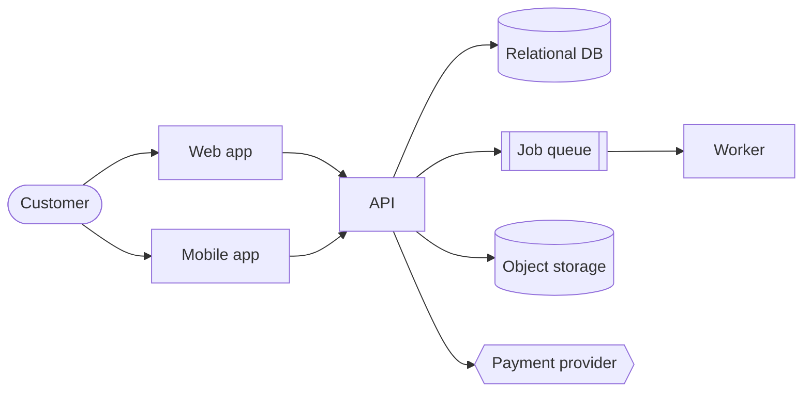
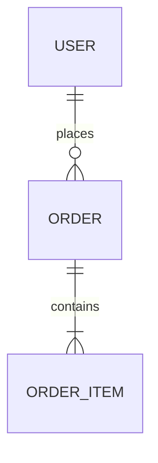

# Architecture document — template

```markdown
# <System> — architecture

**Date:** <YYYY-MM-DD>  **Author:** <name>  **Status:** draft | agreed

## 1. Context and goals
<What the system does, for whom, and links to the PRD and strategy brief.>

## 2. Quality attribute scenarios
| ID | Attribute | Scenario | Target |
|---|---|---|---|
| Q1 | Performance | Shopper loads product list on 4G | p95 < 1.5 s |
| Q2 | Availability | Checkout API | 99.9% monthly |

## 3. System context (C4 level 1)
<Mermaid diagram: people, the system, external systems.>

## 4. Containers (C4 level 2)
<Mermaid diagram: web app, mobile app, API, database, queue, storage.>

| Container | Responsibility | Technology (option) | Owner |
|---|---|---|---|

## 5. Components (C4 level 3, only where useful)
<Modules inside the API and how they talk.>

## 6. Data model
<See "Data model" below.>

## 7. APIs
<Link to the contract file and summary of resources.>

## 8. Cross-cutting concerns
- Authentication / authorisation:
- Validation and error handling:
- Logging, metrics, tracing:
- Caching:
- Background jobs and scheduling:
- File storage:
- Notifications:

## 9. Deployment view
<Environments and how containers map to infrastructure. Hand-off to DevOps.>

## 10. Quality check
| Scenario | How the design meets it | Trade-off accepted |
|---|---|---|

## 11. Risks and open questions

## 12. Decisions
- ADR-001 <title> — <link>
```

## Diagram example (Mermaid)



## Data model

| Entity | Key fields | Relationships | Owner module | Personal data? | Lifecycle |
|---|---|---|---|---|---|
| User | id, email, created_at | 1–n Order | accounts | yes | soft delete, purge after 30 days |
| Order | id, user_id, status, total | n–1 User, 1–n OrderItem | orders | indirect | retained 7 years |

Include an ER diagram:



## Decision record

```markdown
# ADR-<number>: <title>

**Date:** <YYYY-MM-DD>  **Status:** proposed | accepted | superseded by ADR-<n>

## Context
## Options considered
## Decision
## Consequences
```
